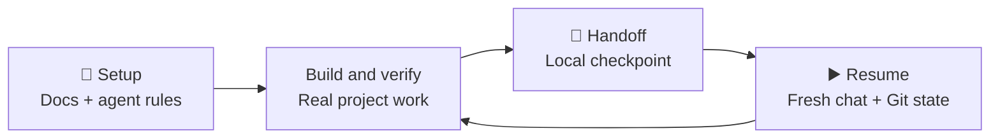

<h1 align="center">🧵 Orbit Thread</h1>

<p align="center"><strong>Pick up where you left off. Know what to do next.</strong></p>

<p align="center">Lean coding-session continuity for <strong>Codex</strong> and <strong>Claude Code</strong>, plus optional, read-only GitHub intelligence through <strong>Orbit Next MCP</strong>.</p>

<p align="center">
  <a href="https://www.npmjs.com/package/orbit-thread"></a>
  <a href="https://github.com/shab1h-gh/orbit-thread/actions/workflows/ci.yml"></a>
  <a href="https://github.com/shab1h-gh/orbit-thread/releases/tag/v1.3.0"></a>
  <a href="https://mcp.orbit.convio.io/health"></a>
  <a href="LICENSE"></a>
</p>

<p align="center">
  <a href="#quick-start"><strong>Quick start</strong></a> ·
  <a href="#orbit-next-remote-github-intelligence">Orbit Next MCP</a> ·
  <a href="#how-it-works">How it works</a> ·
  <a href="#handoff-and-resume">Handoff &amp; Resume</a> ·
  <a href="#command-reference">CLI commands</a> ·
  <a href="#troubleshooting">FAQ</a>
</p>

---

## A complete workflow, without the context bloat

Orbit Thread keeps durable project knowledge in your repository and short-lived execution context in a local, Git-ignored handoff. **Git and current project files stay authoritative.** Orbit Next adds an *optional*, separate service for analysing **public GitHub repositories**.

| Capability | What you get | Where it runs |
| :--- | :--- | :--- |
| 🧭 **[Orbit Setup](#what-setup-creates)** | Lightweight living docs, agent instructions and bounded-subagent preferences. | Local |
| 💾 **[Handoff](#when-to-save-a-handoff)** | A verified, overwrite-only checkpoint in `HANDOFF-STATE.md` (maximum 50 lines). | Local |
| ▶️ **[Orbit Resume](#orbit-resume-starting-a-fresh-session)** | A fresh-session starting point from handoff, current Git state and relevant docs. | Local, read-only |
| 🔎 **[Orbit Next MCP](#orbit-next-remote-github-intelligence)** | Source-backed next actions, CI-failure investigation and release-readiness checks. | Remote, read-only |

The three continuity skills **work without Orbit Next**. Orbit Next cannot access your local workspace, private repositories, uncommitted changes or handoff files.

## Quick start

> **Requirements:** Node.js 20+, macOS or Linux. Run installation commands from your project root.

Install the three local skills and prepare the project:

```bash
npx orbit-thread install
npx orbit-thread setup
```

Choose Codex, Claude Code or both when prompted. For a non-interactive project installation:

```bash
npx orbit-thread install --agent both --scope project --yes
npx orbit-thread setup --agent both --yes
```

**Use the skills in your coding agent's chat**, not in Terminal:

| Agent | Setup | Save progress | Resume work |
| :--- | :--- | :--- | :--- |
| **Codex** | `$orbit-setup` | `$handoff` | `$orbit-resume` |
| **Claude Code** | `/orbit-setup` | `/handoff` | `/orbit-resume` |
| **Claude marketplace plugin** | `/orbit-thread:orbit-setup` | `/orbit-thread:handoff` | `/orbit-thread:orbit-resume` |

**Want public GitHub analysis too?** Connect [Orbit Next](#connect-orbit-next-to-your-agent). It requires no GitHub login or token from you.

## Orbit Next: remote GitHub intelligence

**Live in v1.3.0:** [`https://mcp.orbit.convio.io/mcp`](https://mcp.orbit.convio.io/mcp) · [Health](https://mcp.orbit.convio.io/health) · [Release](https://github.com/shab1h-gh/orbit-thread/releases/tag/v1.3.0)

Orbit Next is a stateless, [Streamable HTTP MCP](https://modelcontextprotocol.io) server running on Cloudflare Workers. It reads **public GitHub metadata only**, applies deterministic rules and returns evidence with links. It doesn't use an AI API, require user credentials or perform GitHub write actions.

### Three tools, each read-only

| Tool | Question it answers | Evidence & limits |
| :--- | :--- | :--- |
| **`get_project_next_actions`** | What should I work on next? | Prioritised actions from recent commits, issues, PRs, default-branch CI and `ROADMAP.md`, with severity, links and `verified` / `heuristic` labels. Missing evidence appears as `unknowns`. |
| **`diagnose_ci_failure`** | What failed in GitHub Actions? | Failed jobs, steps and bounded sanitised annotations. The optional `run_id` selects a run; otherwise it checks the latest failed run on the default branch. **Root cause is not assumed.** |
| **`assess_release_readiness`** | Is this repository technically ready for release? | `PASS` / `WARN` / `BLOCKED` / `UNKNOWN` for CI, PRs, manifest versions, changelog and existing tags. Human approval and publication remain outside the tool's remit. |

All three take `owner` and `repo`. `diagnose_ci_failure` also accepts an optional positive integer `run_id`.

### Connect Orbit Next to your agent

**Claude Code — install the GitHub-hosted plugin**, which bundles Setup, Handoff, Resume and the Orbit Next MCP configuration:

```bash
claude plugin marketplace add shab1h-gh/orbit-thread
claude plugin install orbit-thread@orbit-thread
claude mcp list
```

In Claude Code's chat, the equivalent installation commands begin with `/plugin`; see [installation options](#claude-github-marketplace). The list should show an `orbit-next` connection. The bundled `plugin/.mcp.json` supports an `ORBIT_NEXT_URL` override for development or self-hosting.

**Codex CLI — connect to the same production server:**

```bash
codex mcp add orbit-next --url https://mcp.orbit.convio.io/mcp
codex mcp list
```

This **direct MCP connection and all three tool calls were verified in Codex CLI**. Installing the *combined portable plugin ZIP* in Codex has **not** been tested. Installing the local skills with `npx orbit-thread install` is a separate step.

**Other Streamable HTTP MCP clients:** Add a remote MCP server named `orbit-next` with URL `https://mcp.orbit.convio.io/mcp`. The endpoint is an MCP protocol endpoint, not a website to browse.

### Try it with a real public repository

Ask your connected agent:

> Using Orbit Next, assess release readiness and identify the next actions for `shab1h-gh/orbit-thread`. Label verified facts, heuristics and unknowns, and include GitHub source links. Don't change anything.

Or investigate a **known failed CI run**:

> Using Orbit Next, diagnose `cli/cli` GitHub Actions run `37915254425`. Identify the failed job and step, and distinguish evidence from any unconfirmed root cause.

In the verified CI example, the tool found a failed `govulncheck` job and **Check Go vulnerabilities** step; it did **not** invent a root cause. See the [GitHub Actions run](https://github.com/cli/cli/actions/runs/37915254425) and [review evidence](docs/REVIEW.md#codex).

> [!NOTE]
> Results depend on the repository's **current** public GitHub state. For example, a release-readiness `WARN` can be correct when the requested version is **already tagged and published**. It does not mean the existing release failed.

### Local skills vs remote MCP

| | Setup, Handoff & Resume | Orbit Next |
| :--- | :--- | :--- |
| Data read | Local Git state, relevant project docs and local handoff | Requested public GitHub repository, issues, PRs, Actions metadata |
| Network during execution | None from the skills (installation via npm may use network) | HTTPS to the Worker and public GitHub endpoints |
| Can edit your project? | Setup and Handoff intentionally create/update local files; Resume is read-only | **No** |
| Credentials from users | None | None |
| Storage | Local project files | No database or persistent user records; public GitHub responses may be edge-cached for five minutes |

### Availability, security & limits

- **Public repos only.** No private repository access, GitHub mutations, private workflow logs or local file access.
- **Bounded lookups.** First-page PR/issue results, GitHub Actions CI, per-call request budgets and timeouts. Evidence is labelled; gaps are not silently filled.
- **Rate limits.** Cloudflare allows 30 requests per minute per IP; GitHub imposes its own quota. The service operator has configured an optional public-repositories-only GitHub token to raise the upstream limit. **Users never need to provide credentials.**
- **No inference charges or user accounts.** The Worker uses deterministic checks, public data and a short public-data cache. No application database or request-body telemetry is added.
- **Validation.** Production acceptance passed 23/23 protocol, security and functional checks; Claude Code and Codex CLI have both called the tools successfully.
- **Directory status.** Public npm and GitHub release are available; OpenAI and Anthropic directory publication is **not** claimed. See [submission notes](docs/SUBMISSION.md).

Read [Security](SECURITY.md), [Privacy](PRIVACY.md), [Architecture](docs/ARCHITECTURE.md) and [Operations](docs/OPERATIONS.md) for technical and operational detail.

### Self-hosting (optional)

You do **not** need your own Worker to use the live endpoint. To deploy a separate copy using your own Cloudflare account, start with the `worker/` package:

```bash
cd worker
npm ci --ignore-scripts
npm run typecheck
npm test
npx wrangler deploy --config ./wrangler.jsonc --env staging
node scripts/e2e.mjs https://<your-staging-host>/mcp
```

Review the Worker name, environment, domain, bindings and token handling **before** deploying; do not deploy to the existing production domain. The [operations guide](docs/OPERATIONS.md) covers acceptance criteria, explicit environments, secrets and rollback.

## How it works

Orbit Thread keeps **lasting project knowledge** separate from **the task you're doing right now**.



| Source | Role |
| :--- | :--- |
| **Git** | Code history, active branch and working-tree truth. |
| **Living docs** | The current product, design, architecture, security and roadmap. |
| **`HANDOFF-STATE.md`** | Short local checkpoint of verified progress and unfinished work. |
| **Resume** | Reconciles that checkpoint with current Git and only the relevant docs. |

> [!IMPORTANT]
> A handoff isn't a changelog or synchronised chat history. **Current repository evidence overrides stale notes.**

## What setup creates

Orbit Setup can prepare a new project or add the workflow to an existing one. It creates missing files without duplicating equivalent documents already in the repository root or `docs/`.

```text
project/
├── AGENTS.md
├── CLAUDE.md                 # if Claude Code is selected
├── .orbit-thread/
│   └── config.json           # tracked project preferences
└── docs/
    ├── PRODUCT.md
    ├── DESIGN.md
    ├── ARCHITECTURE.md
    ├── SECURITY.md
    └── ROADMAP.md
```

The first successful Handoff also creates `HANDOFF-STATE.md`. That file and Orbit Thread's local ownership state are ignored by Git.

### Which document should change?

| Work completed | Update |
| --- | --- |
| Product behaviour, copy or scope | `PRODUCT.md` |
| Interface, layouts or user experience | `DESIGN.md` |
| Runtime, data flow or integrations | `ARCHITECTURE.md` |
| Authentication, permissions or secrets handling | `SECURITY.md` |
| Plans that have not been implemented | `ROADMAP.md` |

The generated instructions ask coding agents to read only the documents and source files they need. After verified changes, they should **update the relevant sections in place**, not pile new notes underneath old ones.

They also tell agents to preserve applied migrations, leave history to Git and run an appropriate check before claiming work is finished.

## Handoff and Resume

### When to save a handoff

Save a Handoff **after verified work**, before clearing a chat or when nearing a context/usage limit. It is useful after a meaningful milestone or a completed coding task, not for every question or trivial edit. Each checkpoint **overwrites** the previous one.

### What gets saved?

The local, Git-ignored `HANDOFF-STATE.md` records a compact checkpoint, usually about 30 lines, with a **50-line maximum**:

```markdown
# Handoff State

Updated: 12-10-2026 08:30

## Current objective
- Complete account security settings.

## Completed milestones
- Added the settings route.
- Connected password changes and session revocation.

## In progress
- Passkey management UI.

## Current state
- Branch: feature/security-settings

## Open issues / risks
- Passkey removal needs browser verification.

## Immediate next steps
1. Finish passkey management.
2. Run the authentication suite.

## Verification
- Typecheck passed.
- Unit tests passed: 42/42.
```

**v1.2.1 compatibility:** Resume also recognises `## Completed this session`, while keeping `## Completed milestones` canonical. If both have entries, it uses the canonical heading without duplicates. It handles **multiple entries, blank lines and subheadings**, showing up to six entries per section to keep the summary compact.

Handoff validates the replacement, checks recognisable secret patterns and writes atomically. It makes no network requests or Git changes. Never put credentials or sensitive personal/production details in a handoff.

### Orbit Resume: starting a fresh session

**Orbit Resume turns a previous checkpoint into an evidence-based starting point for a new chat.** It reads the latest usable handoff, current Git status and only the living docs relevant to the next task. You don't need to paste your old conversation into the new one.

After Setup, your project instructions ask the agent to run Resume **once at the start of a fresh coding session**. Automatic invocation varies by host; the reliable fallback is a manual skill call:

| Where | Type in the **agent chat** |
| :--- | :--- |
| **Codex** | `$orbit-resume` |
| **Claude Code** | `/orbit-resume` |
| **Claude GitHub marketplace plugin** | `/orbit-thread:orbit-resume` |

**Terminal-only summary:** run this from your project's root:

```bash
npx orbit-thread@latest resume
```

That CLI command is read-only and **does not launch a coding agent**. Running `npx` may fetch the package from npm if needed; the Resume **skill itself never runs `npx` or installs tools**. Don't rerun the skill repeatedly in the same conversation.

#### What Resume recovers

| Signal | What it tells you |
| :--- | :--- |
| **Objective and milestones** | Previously recorded goals and verified achievements, with explicit unknowns where evidence is missing. |
| **Unfinished work** | In-progress tasks, risks, verification notes and recorded next actions. |
| **Current Git state** | Branch and dirty/untracked changes, without modifying your work. |
| **Relevant living docs** | Pointers to `PRODUCT.md`, `DESIGN.md`, `ARCHITECTURE.md`, `SECURITY.md` or `ROADMAP.md` when the task needs them. |

Missing, invalid or **possibly outdated** handoffs are reported instead of trusted blindly. A changed branch, a handoff date in the future or a newer Git commit date may flag a checkpoint as outdated. Current Git and tracked docs take priority; Resume never invents missing objectives or verification.

#### Common Resume use cases

| Situation | Recommended action |
| :--- | :--- |
| **Fresh chat after a long task** | Write `$handoff` or `/handoff` after verified progress, then Resume in the next chat. |
| **Context or usage limit** | Checkpoint before the limit when possible, then restart a conversation in the same project. |
| **Switching Codex ↔ Claude Code** | Install for both agents in the **same local repo**; either agent can Resume from the same checkpoint and Git state. |
| **Returning after days away** | Resume, review any stale-branch or commit warning, then consult only current relevant docs. |
| **Working tree has uncommitted edits** | Resume identifies current changes **without** reset, clean, stash, stage or commit. |
| **No handoff yet / new clone** | Resume reports what's unknown; give the agent the current task and let it inspect relevant current files. |

#### Example: carry on without your old conversation

**1. Save a checkpoint.** After completing and verifying part of a feature, type `$handoff` in Codex or `/handoff` in Claude Code.

**2. Start a fresh chat** in the same project. If Resume doesn't start automatically, type `$orbit-resume` or `/orbit-resume`.

**3. Continue from the recovered context.** For example:

> Continue the unfinished account settings feature. Preserve my uncommitted changes, check current Git state, and read only the files needed for the next step.

#### Safety and limitations

- **Read-only:** Resume does not modify files or Git, reset, clean, stash, stage, commit, checkout, deploy or push.
- **Selective context:** The skill checks the handoff, Git summaries and task-relevant living docs; it doesn't read `.env`, `.dev.vars`, private keys or unrelated files.
- **Conservative redaction:** Secret-looking values and paths are hidden. Benign lines mentioning `token` or `secret` may also be redacted.
- **Bounded input/output:** Handoff is capped at 50 lines; the terminal CLI refuses symlinks, invalid dates and files larger than 32 KB.
- **Local state:** `HANDOFF-STATE.md` is Git-ignored, so it doesn't automatically transfer to a different machine or clean clone.
- **Evidence first:** Resume cannot recover facts nobody recorded or prove an unverified test passed. Current repository state overrides stale notes.

## Configure subagents

Orbit Thread only **records preferences**. It does not launch subagents itself.

By default, agents should use helpers only when the work warrants them. The configured maximum is **two**, and helpers should not spawn further helpers.

**Set the limit:**

```bash
npx orbit-thread configure --max-subagents 2
```

**Turn subagents off:**

```bash
npx orbit-thread configure --max-subagents 0
```

**Save preferred models and reasoning:**

```bash
npx orbit-thread configure --agent codex --model "GPT-6 Luna" --reasoning high
npx orbit-thread configure --agent claude --model "Claude Sonnet 5.5" --effort medium
```

**Check the saved settings:**

```bash
npx orbit-thread configure --show
```

**Reset one agent's preferences:**

```bash
npx orbit-thread configure --agent claude --reset-subagents
```

The settings live in `.orbit-thread/config.json` and are reflected in Orbit Thread's managed section of `AGENTS.md`. They are preferences, not requirements. If a named model is unavailable, the agent can use a suitable alternative.

## Check your setup

> 🩺 **Doctor** checks Orbit Thread itself. It does not test whether your application works.

Run it after installing, updating, changing configuration or moving to a fresh checkout:

```bash
npx orbit-thread doctor --agent both --scope project
```

Or check each integration separately:

```bash
npx orbit-thread doctor --agent codex --scope project
npx orbit-thread doctor --agent claude --scope project
```

Doctor checks skill versions (including Resume), project configuration, managed instruction blocks, living docs, Git ignore rules and handoff size.

**How do you know it passed?** A successful command exits with status `0`. To print a clear confirmation:

```bash
npx orbit-thread doctor --agent both --scope project && echo "Orbit Thread Doctor passed"
```

A nonzero result means the continuity setup needs attention. It does **not** necessarily mean your app or deployment is broken.

For a quicker check of installed managed skills only:

```bash
npx orbit-thread check
```

## Installation options

### Requirements

- **Node.js 20 or later**
- **Git** for normal repository work
- **POSIX shell and standard Unix tools** for the handoff writer

Orbit Thread supports **macOS and Linux**. For Windows, use **WSL**; native Windows is not currently supported.

### npm for Codex or Claude Code

```bash
npx orbit-thread install
```

| Agent | Project skill directories |
| --- | --- |
| Codex | `.agents/skills/handoff/`, `.agents/skills/orbit-setup/` and `.agents/skills/orbit-resume/` |
| Claude Code | `.claude/skills/handoff/`, `.claude/skills/orbit-setup/` and `.claude/skills/orbit-resume/` |

A user level install uses the equivalent directories under `~/.agents/skills/` or `~/.claude/skills/`.

### Claude GitHub marketplace

In **Claude Code**, run:

```text
/plugin marketplace add shab1h-gh/orbit-thread
/plugin install orbit-thread@orbit-thread
```

Or use these Terminal commands:

```bash
claude plugin marketplace add shab1h-gh/orbit-thread
claude plugin install orbit-thread@orbit-thread
```

This GitHub marketplace route is separate from the **official Anthropic public directory**. Installing from GitHub does not mean the plugin has been approved for that directory.

## Command reference

| Command | Purpose |
| --- | --- |
| `npx orbit-thread install` | Install the three skills for selected agents. |
| `npx orbit-thread setup` | Prepare or update project docs and managed instructions. |
| `npx orbit-thread resume` | Print a concise, read-only project and Git summary; takes no extra options. |
| `npx orbit-thread configure` | Save project subagent preferences. |
| `npx orbit-thread doctor` | Check the project's continuity setup. |
| `npx orbit-thread check` | Check managed skill installation only. |
| `npx orbit-thread@latest update` | Update managed skills that have not been locally changed. |
| `npx orbit-thread uninstall` | Remove managed skills and blocks, preserving project docs and state. |
| `npx orbit-thread init` | Older alias for `setup`. |

Common options:

```text
--agent codex|claude|both
--scope project|user
--yes
```

### Update an existing installation

```bash
npx orbit-thread@latest update --agent both --scope project --yes
npx orbit-thread@latest setup --agent both --yes
npx orbit-thread doctor --agent both --scope project
```

The update command protects locally edited managed skill files. Setup updates managed project instructions and creates missing living docs without replacing existing equivalents.

### Moving from Orbit Handoff 1.0.x

Orbit Thread is the successor to **Orbit Handoff**. The v1.1 and later CLI recognises compatible older managed installations and state while preserving local edits.

```bash
npx orbit-thread@latest update --agent both --scope project --yes
npx orbit-thread@latest setup --agent both --yes
npx orbit-thread doctor --agent both --scope project
```

The old `orbit-handoff` binary name remains an alias inside the new package. Earlier npm releases remain unchanged.

If you installed the Claude GitHub marketplace plugin, update or reinstall it from `shab1h-gh/orbit-thread` and run `/orbit-thread:orbit-setup`.

## Troubleshooting

<details>
<summary><strong>Orbit Next does not appear in Codex or Claude Code</strong></summary>

For Codex, run `codex mcp list`. If `orbit-next` is missing, add it with `codex mcp add orbit-next --url https://mcp.orbit.convio.io/mcp`. For Claude Code, check `claude mcp list` after installing or updating the plugin from this repository. Restart the agent session if it loaded its tools before you connected the server. The local skills are installed separately with `npx orbit-thread install`.

</details>

<details>
<summary><strong>Orbit Next returns a rate-limit warning or INCONCLUSIVE E2E result</strong></summary>

The Cloudflare per-IP limiter and GitHub's upstream quota are separate. Slow requests or retry after the indicated interval; an E2E `INCONCLUSIVE` result is **not** a pass. The operator-managed GitHub token is a Cloudflare secret, not something users should paste into an agent prompt. See [Operations](docs/OPERATIONS.md).

</details>

<details>
<summary><strong>Orbit Next cannot find my repository or read CI logs</strong></summary>

Orbit Next intentionally works with **public repositories** only and reports private or missing repositories as unavailable. It uses public GitHub Actions job/step status and limited check annotations; it does **not** fetch private workflow logs or establish an unverified root cause. Provide a run ID to diagnose a particular failure.

</details>


<details>
<summary><strong>Resume did not start automatically or the skill is missing</strong></summary>

Automatic invocation depends on the coding host and its skill discovery. Use `$orbit-resume`, `/orbit-resume` or `/orbit-thread:orbit-resume` **in the agent chat**.

If the skill is not found, verify the correct installation and scope:

```bash
npx orbit-thread doctor --agent both --scope project
```

You may need a fresh agent session to load new skills. A working `npx orbit-thread resume` Terminal command doesn't itself prove native skill discovery.

</details>

<details>
<summary><strong>Resume reports a missing, invalid or outdated handoff</strong></summary>

`HANDOFF-STATE.md` is local and Git-ignored; a fresh clone may not contain it. An invalid handoff might have a malformed date or heading, missing objective, excessive size or unsupported file type. An outdated warning may reflect a changed branch, future handoff date or newer Git commit. Check current repository evidence, preserve any unfinished work and save a new verified checkpoint when appropriate.

</details>

<details>
<summary><strong>Resume missed a milestone or redacted harmless text</strong></summary>

Use `## Completed milestones` for new checkpoints; v1.2.1 also reads `## Completed this session` and multiple entries per section. When both headings exist, the canonical one wins. Outdated handoffs are not accepted as verified progress. Privacy safeguards can redact an innocent sentence containing terms such as `secret` or `token`. Verify against the local handoff and Git without exposing sensitive data.

</details>

<details>
<summary><strong>Doctor reports a changed AGENTS.md or CLAUDE.md block</strong></summary>

A Markdown formatter can change whitespace inside an Orbit Thread managed block. That can fail the integrity check even when the text looks fine.

Inspect the changes first:

```bash
git diff -- AGENTS.md CLAUDE.md
```

**Only if those files have no work you need to keep**, restore them and rerun setup:

```bash
git restore -- AGENTS.md CLAUDE.md
npx orbit-thread setup --agent both --yes
npx orbit-thread doctor --agent both --scope project
```

If you have intentional edits, do **not** restore the whole files. Repair only the affected managed block, then rerun setup and Doctor. Consider excluding `AGENTS.md` and `CLAUDE.md` from Prettier using `.prettierignore`.

</details>

<details>
<summary><strong>Setup refuses to overwrite a managed block</strong></summary>

That protection is deliberate. Orbit Thread will not replace a block it can no longer confirm it owns.

Review the block and its markers, preserve your own instructions, repair the managed portion and run:

```bash
npx orbit-thread setup --agent both --yes
npx orbit-thread doctor --agent both --scope project
```

Do not delete `.orbit-thread/state.json` or remove markers to get around the check.

</details>

<details>
<summary><strong>My handoff was rejected</strong></summary>

Keep `HANDOFF-STATE.md` at **50 lines or fewer**. Remove credentials, tokens, keys and sensitive personal or production information, then retry. The previous successful handoff is preserved when validation fails.

</details>

<details>
<summary><strong>Does Orbit Thread synchronise chats across agents?</strong></summary>

No. It keeps project documents and a local handoff that agents can read. It does not copy conversation history between Codex and Claude Code. A fresh session should check the handoff and Git rather than assume it has the earlier chat's context.

</details>

<details>
<summary><strong>What if a configured model is unavailable?</strong></summary>

The subagent model and reasoning values are suggestions, not enforced settings. Use an appropriate available model and keep the configured helper limit.

```bash
npx orbit-thread configure --show
```

</details>

<details>
<summary><strong>npm reports a cache permission error</strong></summary>

Try the Doctor command in your normal Terminal and check npm's cache before changing any permissions:

```bash
npm config get cache
npm cache verify
```

A restricted coding environment may report a permissions error even when your Mac's cache is healthy. Do not run npm with `sudo` or change ownership without identifying the failing path.

</details>

## Security and privacy

> 🔒 Orbit Thread's skills and CLI run locally. The handoff writer does not send files to an Orbit Thread service, collect telemetry or alter Git. The optional **Orbit Next** MCP is the only networked component: it reads public GitHub data and stores nothing.

The installer protects unmanaged skills and locally modified managed files. Setup leaves unrelated instructions and existing project documents alone. Resume is read-only and conservatively redacts sensitive-looking text and paths in its report.

The secret checker catches some recognisable patterns, **not every type of sensitive information**. Do not include passwords, API keys, recovery codes, personal data or production secrets in handoffs or living docs.

Installing packages or using a coding agent can still involve **npm, GitHub, OpenAI or Anthropic** under those providers' own terms and privacy policies.

Read [Security](SECURITY.md), [Privacy](PRIVACY.md) and [Terms of Service](TERMS.md) for the details.

## Provider directories

The [v1.3.0 release](https://github.com/shab1h-gh/orbit-thread/releases/tag/v1.3.0) includes a portable plugin ZIP with three skills and `plugin/mcp.json` (Agent Plugins 1.0), plus Claude-specific plugin metadata and `plugin/.mcp.json`. The remote MCP is already usable directly from Codex CLI and through the Claude GitHub marketplace plugin.

**npm/GitHub distribution is not the same as official directory approval.** The OpenAI and Anthropic directory submissions have separate review processes and are not presented as published; see [submission preparation](docs/SUBMISSION.md).

## Contributing

Bug reports, documentation improvements and focused pull requests are welcome.

See [CONTRIBUTING.md](CONTRIBUTING.md), or [open an issue](https://github.com/shab1h-gh/orbit-thread/issues).

## Licence

[MIT](LICENSE). Created by **Shabih Anwar**.
